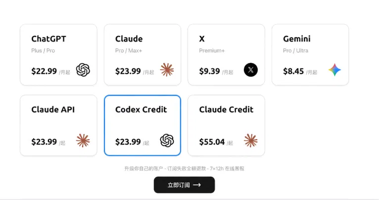
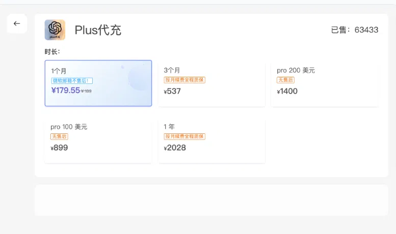
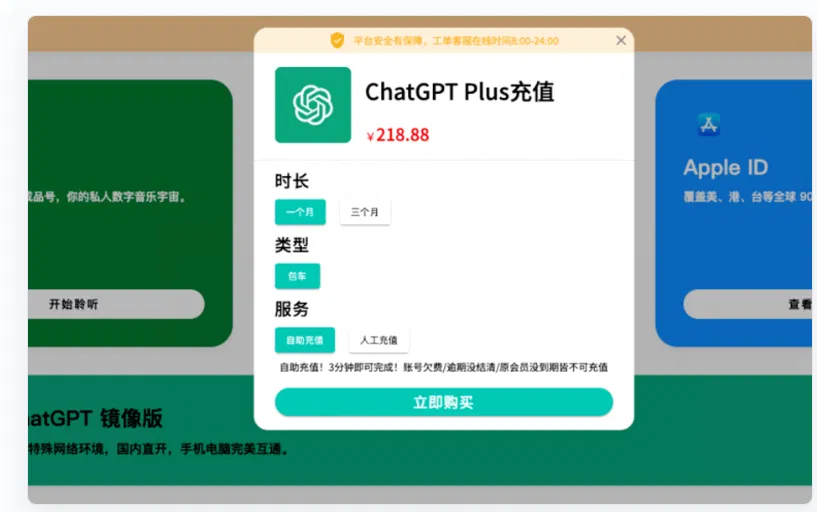

# 2026年 AI 代充平台对比：WildAI vs 其他方案，哪个最划算？

[通过邀请链接进入 WildAI（邀请码 AIG）](https://bewild.ai/?code=AIG)

同样是开 1 个月 ChatGPT Plus，三家平台的价格从 156 元到 218.88 元不等，最多相差 62.88 元。

我们挑了 3 家常见的 ChatGPT 订阅平台，逐一对比了 Plus 的价格。按价格从低到高：

- WildAI：156 元　传送门：[bewild.ai](https://bewild.ai)

- 银河录像局：179.55 元　传送门：[nf.video](https://nf.video/)

- 环球巴士：218.88 元　传送门：[universalbus.cn](https://www.universalbus.cn/)

除了价格，三家能开的服务也不一样：Plus 三家都能开，Pro 只有 WildAI 和银河录像局能开；Codex Credit、Claude Max 和 Claude API 充值，三家里只有 WildAI 支持。

## 一、价格对比

只算 1 个月的 Plus，WildAI 比银河录像局便宜 23.55 元，比环球巴士便宜 62.88 元。

点击图片可查看完整电子表格

银河录像局的 3 个月和 1 年套餐折合每月约 179 元和 169 元，长期买并不更便宜多少。它的 Pro 两档都标注了「无售后」。

## 二、服务覆盖

只用 ChatGPT Plus，三家都能开；要是还用 Claude 或 Codex，目前只有 WildAI 一家能满足。

点击图片可查看完整电子表格

除此之外，WildAI 还能开 Claude Pro、Gemini Pro / Ultra、X Premium 和 Claude Credit。

---

### 总结
2026 年国内订阅 AI 服务的最佳方案取决于你的需求：**怕麻烦选 WildAI（首次注册填邀请码 AIG 减免1美元），重安全选虚拟信用卡，千万别选共享账号。** 无论选哪种，都要确保使用自己的独立账号，保护好你的数据隐私。

---

## 来源与维护

- WildAI 产品入口：[bewild.ai](https://bewild.ai/?code=AIG)
- ChatGPT 套餐与权益：[OpenAI ChatGPT Pricing](https://openai.com/chatgpt/pricing/)
- Claude 套餐与权益：[Anthropic Pricing](https://www.anthropic.com/pricing)
- 以上链接供读者核查，不表示这些来源为原稿中的所有主张背书。
- 原稿标注更新：2026年10月；仓库整理日期：2026-10-14。

## 继续阅读

[教程目录](../README.md) · [注册教程](register-tutorial.md) · [安全与风险](is-wildai-safe.md) · [方案对比](ai-subscription-comparison.md)
