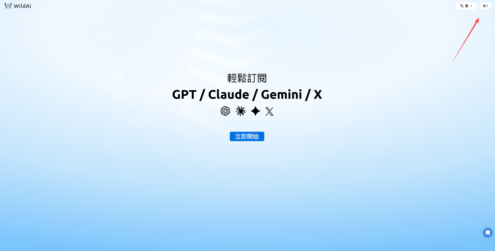
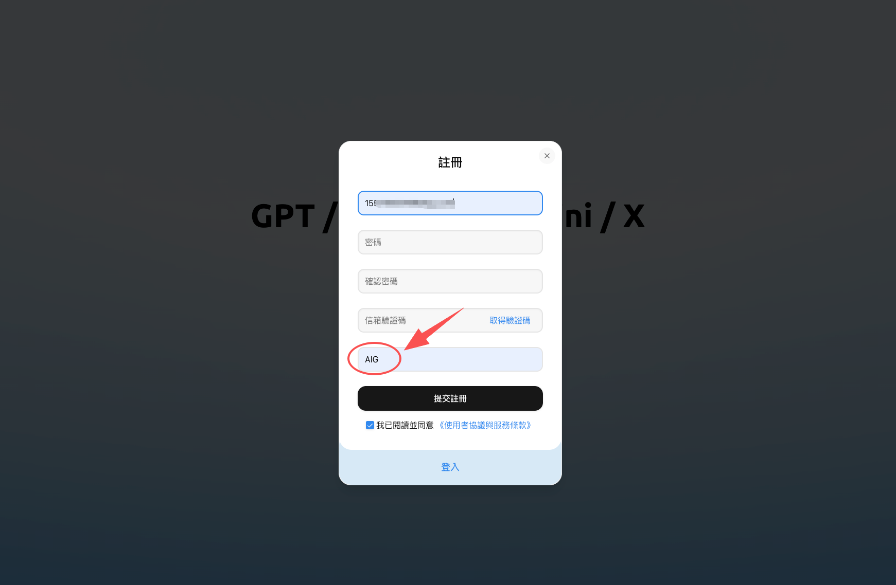
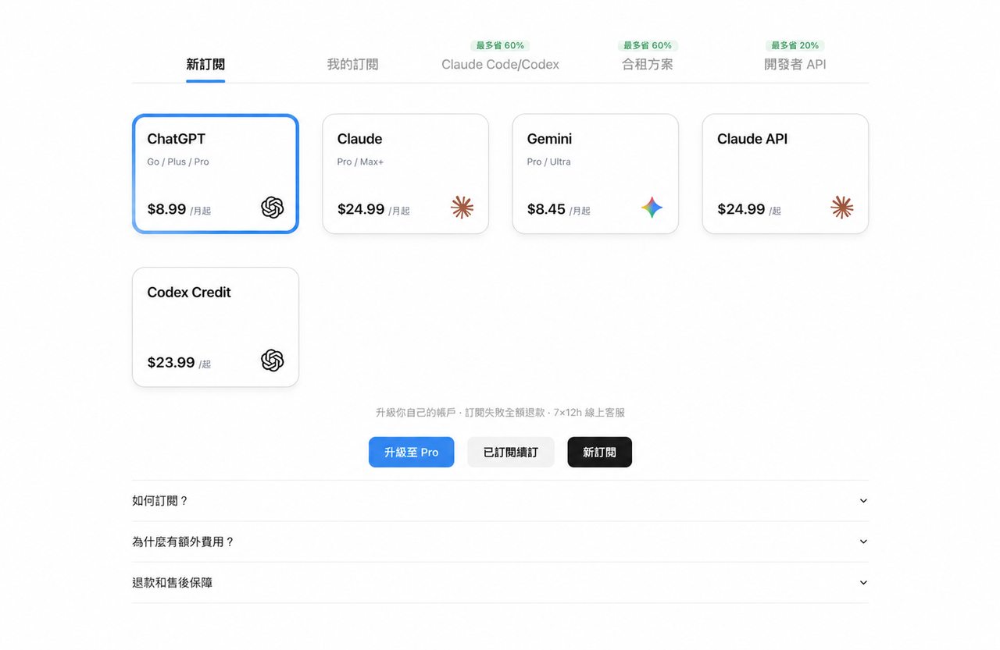
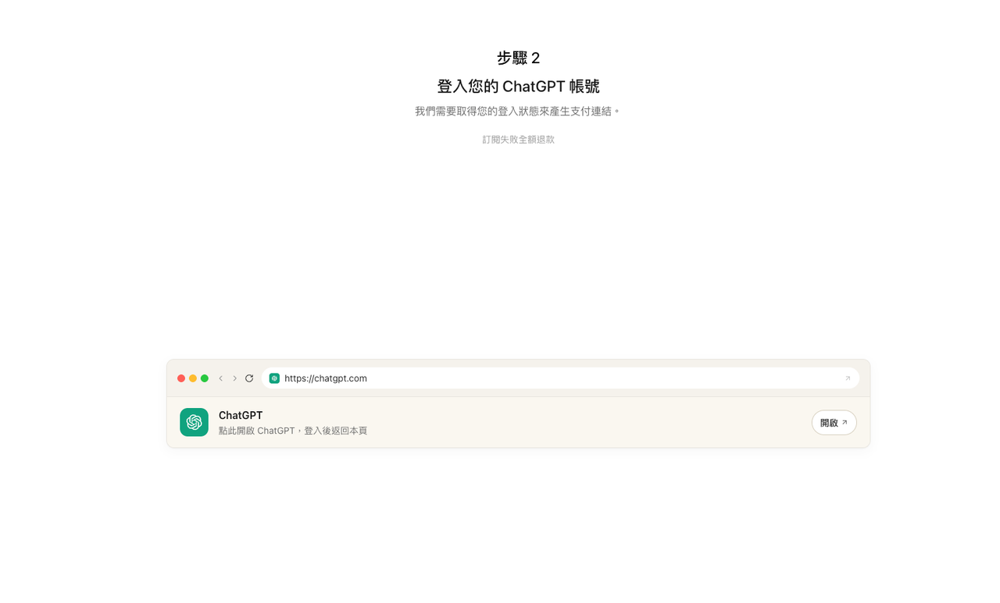

# WildAI 注册教程：邀请码获取、账号设置到首次充值

[通过邀请链接进入 WildAI（邀请码 AIG）](https://bewild.ai/?code=AIG)

这篇教程从零开始，带你完成 WildAI 的注册、设置和首次订阅。整个过程大约 5 分钟。

## 准备工作

你只需要准备两样东西：

- 邮箱（用于注册 WildAI 账号）

- 微信（用于微信支付付款）

不需要海外手机号，不需要海外信用卡，一键订阅ChatGPT/Claude等海外AI产品

## 第一步：访问 bewild.ai

打开浏览器，访问 WildAI 的官网：[bewild.ai](https://bewild.ai/?code=AIG)

你可以用手机浏览器或者电脑浏览器，都可以正常访问。

## 第二步：注册账号

点击页面上的注册按钮，输入你邮箱地址。稍后会收到一封验证邮件

输入验证码，设置密码，注册就完成了。

## 第三步：填写邀请码

首次注册时会有一个邀请码输入框。输入邀请码 AIG 可以减免 1 美元费用。

WildAI 邀请码：AIG（减免 1 美元）

邀请码仅限首次注册时填写，注册完成后无法补填。如果你之前已经注册过但没有填写邀请码，很遗憾无法再补上。

## 第四步：选择要订阅的服务

注册完成并登录后，你会看到 WildAI 支持的各种 AI 服务。目前可以订阅：

- ChatGPT Plus/Pro— OpenAI 的付费会员

- Claude Pro/Max — Anthropic 的付费会员

- Claude API— Anthropic 面向开发者的接口，按 token 计费

- X Premium — 原 Twitter Blue，有蓝标认证、长推文、编辑推文，还能用 Grok AI

- Claude 积分—Claude 的额外用量，会员额度用完后可以继续使用。仅限 WildAI 订阅用户可用

- Codex积分—OpenAI 编程助手 Codex 的额外用量，额度用完后可以继续写代码、跑任务。仅限 WildAI 订阅用户

选择你想要订阅的服务，点击进入订阅页面。

## 第五步：登录你的 AI 账号

以 ChatGPT Plus 为例：

- 在 WildAI 的订阅页面上，按照提示登录你自己的 ChatGPT 账号

- WildAI 需要临时访问你的账号来完成支付操作，登录完成后，WildAI 会确认你的账号状态。

如果你还没有 ChatGPT 账号，需要先去 [chat.openai.com](https://chat.openai.com/) 注册一个免费账号，然后再回来通过 WildAI 升级为 Plus 会员。

## 第六步：支付

确认订阅信息后，使用微信扫描二维码完成付款。

支付金额 = 官方订阅价格（按实时汇率折算人民币）+ WildAI 服务费。

支付完成后，通常几秒钟内你的 AI 服务就会升级成功。

## 订阅成功后

订阅成功后，你可以：

- 直接使用你的 ChatGPT/Claude 账号，享受 Plus/Pro 会员的所有功能

- 在 WildAI 后台查看你的订阅状态和到期时间

- 到期前在 WildAI 上续费

## 常见注册问题

### 收不到验证码怎么办？

- 用邮箱注册，检查垃圾邮件文件夹

- 稍等几分钟后重试

### 邀请码填错了还能改吗？

邀请码只能在首次注册时填写，注册完成后无法补填。所以建议注册时一定记得填写 AIG。

### 注册后多久可以开始订阅？

注册完成后可以立即进行订阅操作，没有等待期。

### 一个 WildAI 账号可以订阅多个服务吗？

可以。你可以同时订阅 ChatGPT Plus 和 Claude Pro，它们之间互不影响。

---

### 总结
WildAI 的注册流程非常简单：访问 bewild.ai → 手机号/邮箱注册 → 填写邀请码 AIG（减免1美元）→ 选择服务 → 登录 AI 账号 → 微信支付付款。全程 5 分钟搞定。

---

## 来源与维护

- WildAI 产品入口：[bewild.ai](https://bewild.ai/?code=AIG)
- ChatGPT 套餐与权益：[OpenAI ChatGPT Pricing](https://openai.com/chatgpt/pricing/)
- Claude 套餐与权益：[Anthropic Pricing](https://www.anthropic.com/pricing)
- 以上链接供读者核查，不表示这些来源为原稿中的所有主张背书。
- 原稿标注更新：2026年10月；仓库整理日期：2026-10-14。

## 继续阅读

[教程目录](../README.md) · [注册教程](register-tutorial.md) · [安全与风险](is-wildai-safe.md) · [方案对比](ai-subscription-comparison.md)
