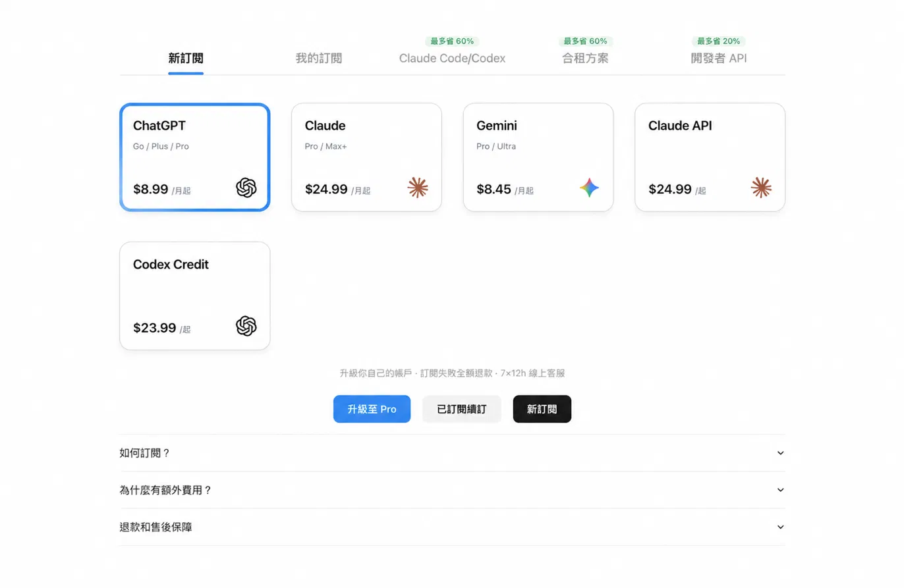
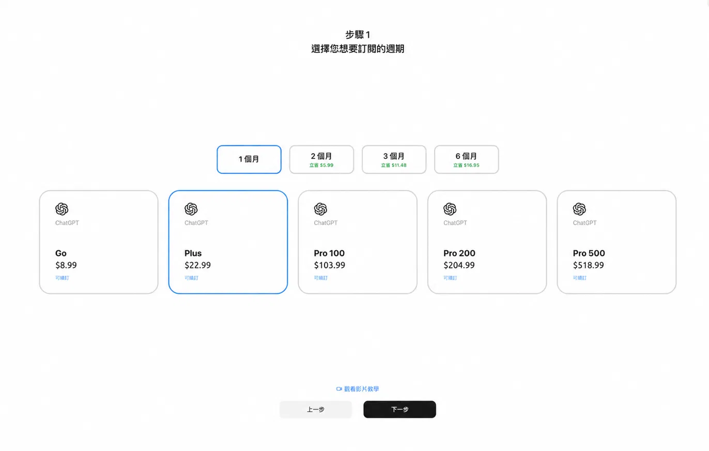
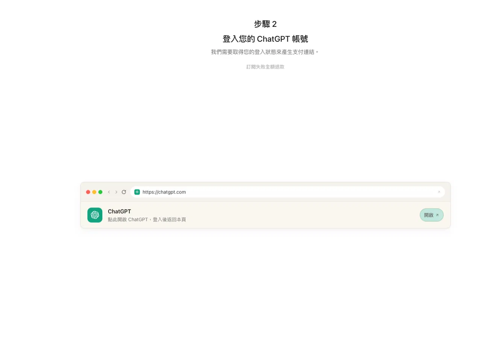
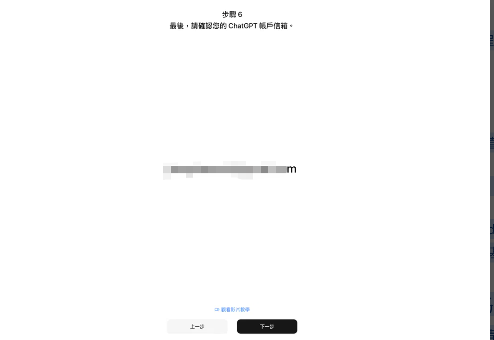
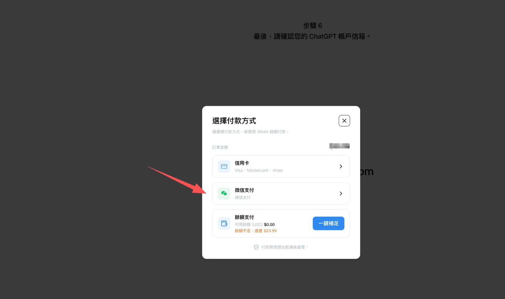
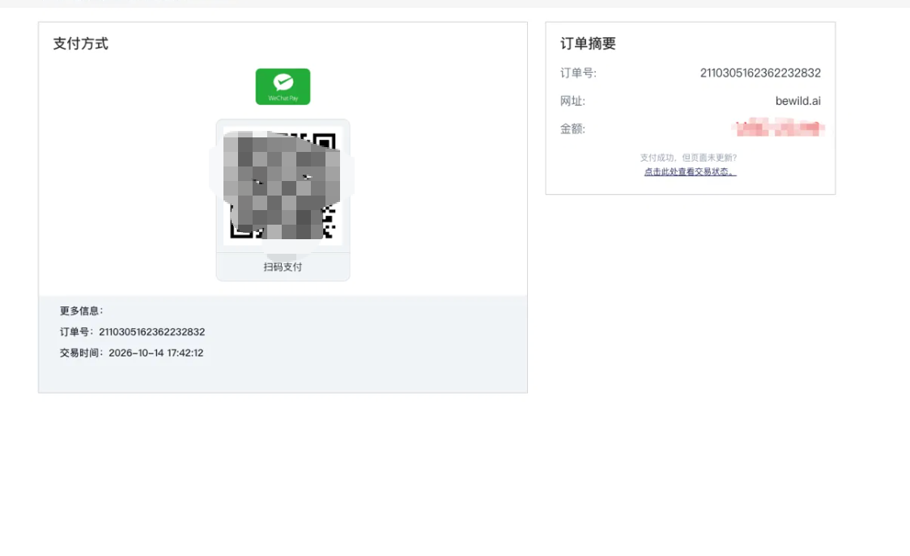
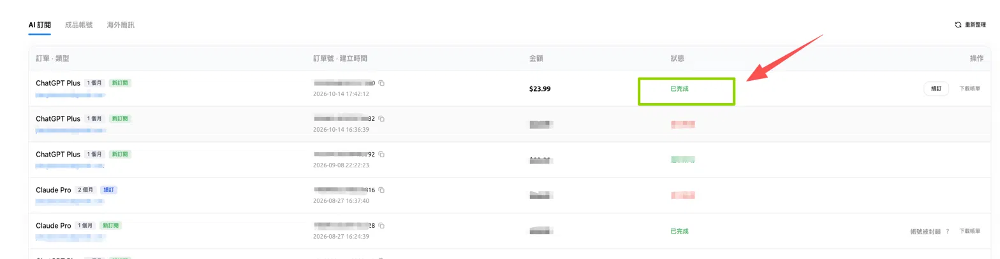

# 如何通过 WildAI 订阅 ChatGPT 会员（图文教程）

[通过邀请链接进入 WildAI（邀请码 AIG）](https://bewild.ai/?code=AIG)

用 WildAI 给自己的 ChatGPT 账号开会员，全程约 5 分钟。下单前记得填写邀请码 AIG，订单立减 1美金。

## 开始前准备

- 一个能正常登录的 ChatGPT 账号：会员会直接开在这个账号上，不用换号，也不跟别人共享

- 一台电脑和浏览器：推荐 Chrome 或 Edge，后面要在同一个浏览器里同时打开 WildAI 和 ChatGPT

- 支付方式：微信支付，或 Visa / Mastercard / Amex 信用卡

- 邀请码 AIG：在下单前填写，在套餐价格的基础上再减 $1

## 第 1 步：登录 WildAI 并填写邀请码

打开 [bewild.ai](https://bewild.ai/?code=AIG)，注册或登录账号。

## 第 2 步：选择 ChatGPT

在「新订阅」页面点击 ChatGPT 卡片（Go / Plus / Pro，$8.99/月起），再点底部的「新订阅」。

如果你之前已经在 WildAI 开过会员，要续费就点「已订阅续订」；从 Plus 升级就点「升级至 Pro」。

## 第 3 步：选择周期和套餐

先在上方选订阅周期，再选套餐，然后点「下一步」。买得越久越划算：选 2 个月立省 $5.99，3 个月立省 $11.48，6 个月立省 $16.95。

套餐下标有「可续订」，到期前可以在 WildAI 直接续费。避免自己的账号变成Free状态

## 第 4 步：登录你的 ChatGPT 账号

点击页面上的「开启」按钮，会在新标签页打开 chatgpt.com。登录你要开会员的那个账号，然后回到 WildAI 页面。

WildAI 需要通过你的登录状态来生成支付链接。如果浏览器里已经登录了别的 ChatGPT 账号，先退出再换成正确的账号。

## 第 5 步：打开 session 页面并复制全部内容

> Session 内容包含敏感登录凭据。本仓库省略相关截图；不要将这些内容发布到公开页面。

- 在同一个浏览器里点击页面上的链接：[https://chatgpt.com/api/auth/session](https://chatgpt.com/api/auth/session)

- 会打开一个只有一大段文字的页面，这是你当前的登录信息（JSON 字符串）

- 先按 Ctrl + A（Mac 用 Cmd + A）全选，再按 Ctrl + C（Mac 用 Cmd + C）复制

## 第 6 步：粘贴并提交

回到 WildAI，把刚才复制的内容粘贴（Ctrl / Cmd + V）到提交框里，点「下一步」。

## 第 7 步：确认 ChatGPT 邮箱

页面会显示你刚才登录的 ChatGPT 账号邮箱。仔细核对是不是要开会员的账号，确认无误后点「下一步」。邮箱不对，就点「上一步」回到第 4 步换账号。

## 第 8 步：选择付款方式并支付

- 微信支付（推荐）：会跳转到支付页，用微信扫二维码付款即可

- 信用卡：支持 Visa、Mastercard、Amex

- 余额支付：用 WildAI 账户里的美元余额付款；余额不足时，点「一键补足」充值差额

支付页会显示订单号和交易时间，建议截图保存。扣费在账单上会显示为 bewild.ai。如果付完款页面没有跳转，点右侧的「点击此处查看交易状态」。

## 第 9 步：确认订阅成功

付款后进入 WildAI 的「我的订阅」→「AI 订阅」，找到刚才的订单。状态显示绿色的 「已完成」，就说明会员已经开好了。状态没更新时，点右上角的「重新整理」。

再回到 ChatGPT 刷新页面，左下角的账号信息里应该能看到你开通的套餐，订单右侧可以「续订」或「下载账单」，到期前直接在这里续费就行。

---

### 总结
通过 WildAI 订阅 ChatGPT Plus 或 Claude Pro，核心流程就是：登录 WildAI → 选择服务 → 登录你的 AI 账号 → 微信支付付款。全程几分钟，不需要海外信用卡。首次注册填写邀请码 **AIG** 可减免 1 美元。

---

## 来源与维护

- WildAI 产品入口：[bewild.ai](https://bewild.ai/?code=AIG)
- ChatGPT 套餐与权益：[OpenAI ChatGPT Pricing](https://openai.com/chatgpt/pricing/)
- Claude 套餐与权益：[Anthropic Pricing](https://www.anthropic.com/pricing)
- 以上链接供读者核查，不表示这些来源为原稿中的所有主张背书。
- 原稿标注更新：2026年10月；仓库整理日期：2026-10-14。

## 继续阅读

[教程目录](../README.md) · [注册教程](register-tutorial.md) · [安全与风险](is-wildai-safe.md) · [方案对比](ai-subscription-comparison.md)
