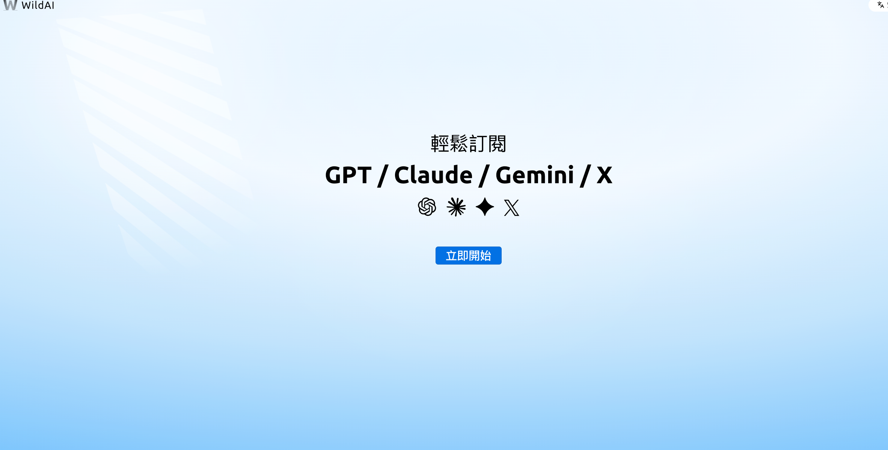
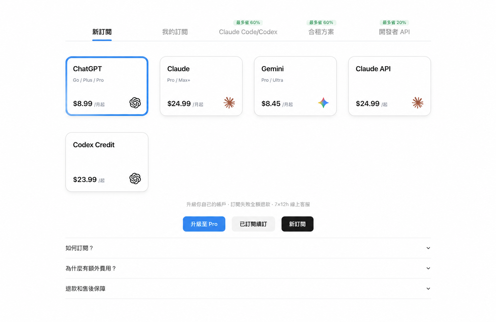
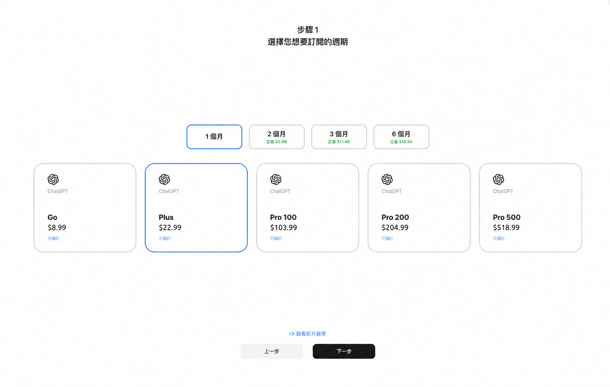
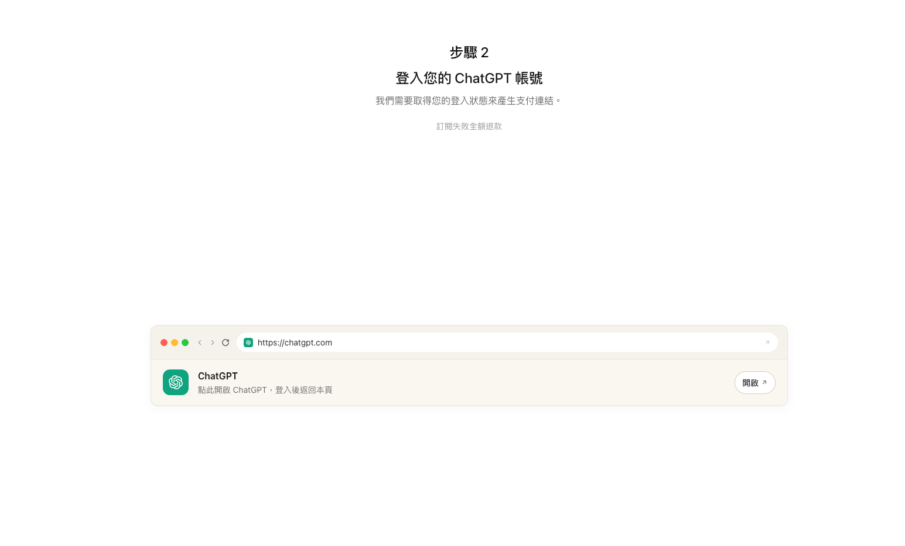
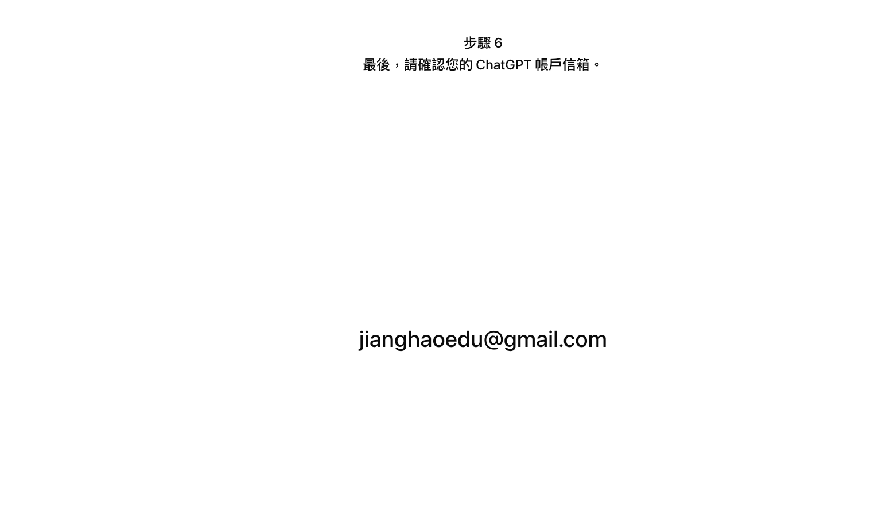
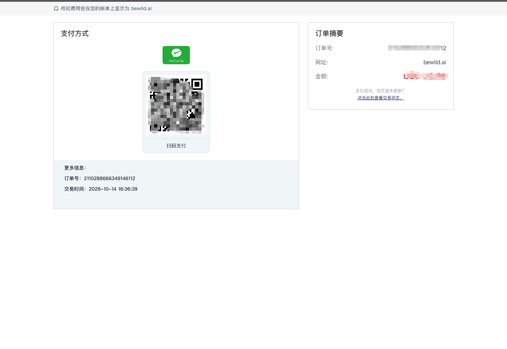

# WildAI 是什么？bewild.ai 完整使用指南

[通过邀请链接进入 WildAI（邀请码 AIG）](https://bewild.ai/?code=AIG)

## 一、Wildai是什么？

WildAI（bewild.ai）是一个帮助国内用户订阅海外 AI 服务的平台。 你不需要海外信用卡、不需要虚拟卡、不需要任何海外支付工具。直接用微信支付付款，就能开通 ChatGPT Plus、Claude Pro 等 AI 会员服务。

截至 2026 年 10 月，WildAI 已服务超过 20 万用户。

## WildAI 支持哪些服务？

目前 WildAI 支持订阅以下 AI 服务：

| 服务 | 说明 |
| --- | --- |
|  ChatGPT Plus/Pro | OpenAI 的付费会员。Plus 可用最新的 GPT 模型，用量更高，还能用图片生成、深度研究、语音等功能；Pro 是高级版，用量基本无限，还能用最强的推理模型，适合重度和专业用户 |
|  Claude Pro/Max | Anthropic 的付费会员。Pro 的用量比免费版高得多，可用最新的 Claude 模型和 Claude Code；Max 是高级版，用量是 Pro 的数倍，高峰期优先使用，适合重度用户 |
|  X Premium | X（原 Twitter）的付费会员，有蓝标认证、长推文、编辑推文，还能用 Grok AI |
| Codex 积分 | OpenAI 编程助手 Codex 的额外用量，会员额度用完后还能继续写代码、跑任务 |
| Claude 积分 | Claude 的额外用量额度，会员额度用完后按量继续使用，不用升级套餐 |
| Claude API | Anthropic 面向开发者的接口，按 token 计费，可以把 Claude 接入自己的应用、脚本或工具 |

所有订阅都是在你自己的账号上操作，WildAI 只负责代付，你的账号仍然完全由你自己控制。

## 二、为什么需要 WildAI？

国内用户直接订阅这些服务会遇到两个主要障碍：

第一，支付障碍。 ChatGPT Plus、Claude Pro 等服务只接受海外信用卡（Visa、Mastercard），国内银行发行的信用卡绑定后大概率会被拒绝。虚拟卡是一个解决方案，但办卡本身也有门槛和费用。

第二，网络障碍。 订阅过程中的支付页面可能需要特定的网络环境，支付成功率受多种因素影响。

WildAI 把这两个问题都解决了：你在 WildAI 平台上选择要订阅的服务，用微信支付付款，WildAI 在后台完成订阅操作，整个过程几分钟搞定。

## 三、使用流程

整个流程分四步：

第一步：注册 WildAI 账号

访问 [bewild.ai](https://bewild.ai/?code=AIG)，使用手机号或邮箱注册。首次注册时填写邀请码 AIG 可减免 1 美元费用（仅限新用户首次注册时填写，注册后无法补填）。

第二步：选择要订阅的服务

进入平台后，选择你要订阅的 AI 服务（比如 ChatGPT Plus）和订阅周期。

第三步：登录你的 AI 账号

按照平台提示，登录你自己的 ChatGPT 或 Claude 账号。WildAI 需要临时访问你的账号来完成支付操作。

第四步：支付

用微信扫码支付。支付完成后，一般几秒钟内你的 AI 服务就会升级成功。

## 四、定价

WildAI 的收费 = 官方订阅价格 + 服务费。具体价格以平台页面显示的实时价格为准，因为汇率会波动。

相比自己办虚拟卡的方式，WildAI 的优势是没有办卡费、没有充值手续费、没有月费，按次付费，用多少花多少。

## 五、售后保障

- 订阅失败全额退款：如果因为任何原因订阅没有成功，费用会全额退还

- 独立账号：订阅的是你自己的账号，不是共享账号，数据完全属于你

## 六、常见问题

### WildAI 和虚拟卡有什么区别？

虚拟卡（）是给你一张虚拟的海外信用卡，你自己去 OpenAI/Anthropic 官网操作支付。WildAI 是代你完成整个支付流程，你只需要微信付款就行，不需要接触任何信用卡操作。

### 订阅后怎么续费？

订阅到期前，你可以在 WildAI 上再次操作续费，会有一个续费按钮。

### 支持企业批量订阅吗？

如果你有团队批量订阅的需求，可以联系 WildAI 客服了解企业方案。

### WildAI 的邀请码是什么？

首次注册时填写邀请码 AIG 可减免 1 美元。注意：邀请码只能在注册时填写，注册完成后无法补填。

---

### 总结
WildAI 解决的核心问题是：**让国内用户用微信支付就能订阅 ChatGPT、Claude 等海外 AI 服务，不需要任何海外支付工具。** 如果你只是想快速开通 AI 会员，不想折腾虚拟卡和海外支付，WildAI 是目前最省事的方案之一。

---

## 来源与维护

- WildAI 产品入口：[bewild.ai](https://bewild.ai/?code=AIG)
- ChatGPT 套餐与权益：[OpenAI ChatGPT Pricing](https://openai.com/chatgpt/pricing/)
- Claude 套餐与权益：[Anthropic Pricing](https://www.anthropic.com/pricing)
- 以上链接供读者核查，不表示这些来源为原稿中的所有主张背书。
- 原稿标注更新：2026年10月；仓库整理日期：2026-10-14。

## 继续阅读

[教程目录](../README.md) · [注册教程](register-tutorial.md) · [安全与风险](is-wildai-safe.md) · [方案对比](ai-subscription-comparison.md)
